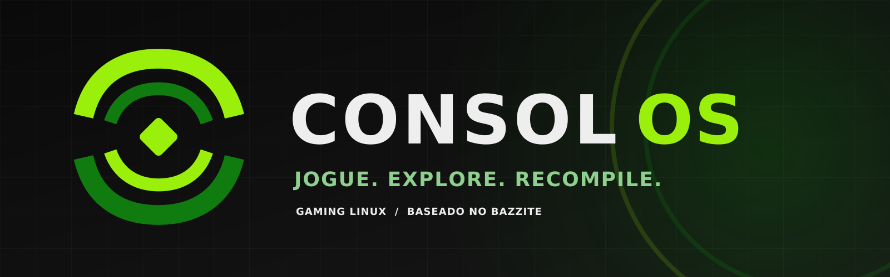

# Consol OS



**Consol OS** é uma distro Linux **focada em jogos** — experiência de console (controle em toda a interface) com opção de modo desktop — baseada no [Bazzite](https://bazzite.gg) (Fedora Atomic, `bootc`), com:

- **Steam integrado de fábrica**, incluindo sincronização de conta e biblioteca (via Bazzite);
- **[RecompLauncher](https://github.com/elripalda/RecompLauncher)** nativo (AppImage empacotado na imagem, integrado ao Steam via "Add to Steam" e ao Big Picture), para jogar os **recompilados da comunidade** (N64Recomp etc.);
- **Proton nativo** para jogos Windows do Steam (já integrado; nada a instalar — basta *Configurações → Compatibilidade → Habilitar Steam Play*);
- **[Heroic Games Launcher](https://heroicgameslauncher.com)** (Epic/GOG/Amazon) via Flatpak, usando Proton por baixo — instalado pela ISO, com botão "Add to Steam" por jogo para jogar tudo no Big Picture;
- **Emuladores**: RetroArch nativo + [RetroDECK](https://flathub.org/apps/net.retrodeck.retrodeck) via Flatpak no instalador, com interface orientada a controle;
- **Experiência de console**: boot para KDE com Steam Big Picture em tela cheia; para ir ao desktop: Quick Access (botão Xbox/Guide) → **Exit to Desktop** ou `Ctrl+Alt+F2` no teclado. O desktop mode fica acessível a qualquer momento, como no SteamOS.

> Status: **v0.1 (em desenvolvimento)**. Ainda não há ISO publicada. Veja o [Roadmap](#roadmap).

## Por que Bazzite e não do zero?

SteamOS ≈ Arch + imagem imutável customizada pela Valve — reproduzir isso do zero é meses de trabalho e manutenção. O Consol herda, prontos e testados: drivers NVIDIA 580.x (necessários para a GTX 750 Ti Maxwell), Gamescope, Steam com Big Picture, Flatpak, sistema imutável com rollback automático (`bootc`) e atualizações atômicas.

## Máquina de desenvolvimento/alvo

Desenvolvido e instalado na máquina do autor, que é o **hardware de referência**:

| Componente | Detalhe |
|---|---|
| CPU | Intel Core i3-2120 (2c/4t @ 3.3 GHz) — abaixo do recomendado pelo Bazzite (quad-core); funciona, com folga estreita para jogos pesados |
| RAM | 8 GB |
| GPU | **NVIDIA GTX 750 Ti** (Maxwell, driver 580.x — Maxwell não é suportada pelo `nvidia-open`) |
| Discos | SSD #1 (128 GB, Windows) · **SSD #2 (128 GB, destino do Consol, será apagado)** · HDD 320 GB (dados/backup) |
| Firmware | UEFI (Windows está em GPT/UEFI); o Bazzite exige UEFI |

> ⚠️ **Aviso (Maxwell)**: a GTX 750 Ti está no fim da linha nos drivers proprietários. Sempre teste a versão antes de publicar releases.

## Estrutura do repositório

```
Containerfile                 # Imagem bootc: FROM bazzite-nvidia:stable + build.sh
build_files/build.sh          # Instalação de pacotes e do RecompLauncher (SHA-256 fixado)
build_files/recomplauncher.sh # Wrapper sem FUSE (APPIMAGE_EXTRACT_AND_RUN=1)
system_files/                 # Arquivos copiados na raiz da imagem (/)
  etc/xdg/autostart/consol-bigpicture.desktop   # Big Picture no login (removível)
  etc/xdg/kdeglobals                            # esquema de cores Consol + ícones/Plasma escuros
  etc/sddm.conf.d/consol.conf                   # tela de login escura (breeze-dark)
  usr/share/applications/recomplauncher.desktop
  usr/share/color-schemes/Consol.colors         # verde sobre preto
  usr/share/icons/hicolor/                      # ícone consol-os (todas as escalas) + recomplauncher
  usr/share/sddm/themes/consol/                 # tema próprio (incluído, desativado até teste na VM)
  usr/share/plymouth/themes/consol/             # boot splash (incluído, não ativado)
  usr/share/wallpapers/Consol/                  # wallpaper oficial (3 resoluções)
brand/                        # identidade visual (masters SVG + PNGs + docs)
disk_config/consol-nvidia.toml # Kickstart da ISO (bootc switch + Flathub + RetroDECK)
disk_config/disk.toml          # Config de disco da imagem anaconda
consol.env                     # Nome/org da imagem (usado pelo Justfile e CI)
```

## Construindo a imagem

### Opção A — GitHub Actions (recomendado)

1. Repositório: `https://github.com/amplidev-apps/consol-os`. Faça push deste diretório na branch `main`.
2. `REPO_ORGANIZATION` em `consol.env` já aponta para `amplidev-apps` e o kickstart (`disk_config/consol-nvidia.toml`) já referencia `ghcr.io/amplidev-apps/consol-os:latest`.
3. O workflow **Build container image** compila e publica em `ghcr.io/amplidev-apps/consol-os:latest` a cada push na `main`.
4. O workflow **Build disk images** gera a ISO (`anaconda-iso`) manualmente (aba *Actions → Build disk images → Run workflow*) e anexa como artefato.
5. Depois do primeiro build, em `ghcr.io` → pacote `consol-os` → *Package settings*: marque o pacote como **público** para o `bootc switch` funcionar em máquinas frescas sem login.

### Opção B — Build local (Linux com podman)

```bash
# na raiz do repositório
just build localhost/consol-os latest   # compila a imagem
just build-iso localhost/consol-os latest  # gera a ISO via bootc-image-builder
```

> Windows não consegue compilar `bootc` localmente sem Linux. No Windows, desenvolva normalmente e deixe a compilação para o Actions (ou use WSL2 com podman).

## Instalação (dual boot com Windows)

> ⚠️ **Backup antes de tudo.** O instalador apaga o disco escolhido.

1. Grave a ISO num pendrive de 16 GB+ (Fedora Media Writer ou Rufus).
2. **Idealmente, desconecte fisicamente o SSD do Windows durante a instalação** (conforme a documentação do Bazzite) e reconecte depois. Alternativa: no particionamento manual do Anaconda, selecione **somente o SSD #2** e marque para formatação.
3. Instale, reinicie e entre no Consol.
4. **Secure Boot**: na primeira instalação, inscreva a chave do Bazzite (MOK) quando solicitado, ou desative o Secure Boot na BIOS. NVIDIA em Secure Boot sem chave inscrita = tela preta.
5. Dual boot: se o GRUB do Bazzite não enxergar o Windows, use o menu de boot UEFI da BIOS (`F11`/`F12`/`F8`, varia por placa H61) — é a recomendação oficial para dual boot em discos separados.

## Pós-instalação

1. **Steam**: abra o Steam, faça login — a sincronização de biblioteca/conta funciona como no Windows.
2. **RecompLauncher**: está no lançador de aplicativos e no menu Game (ícone próprio). No Big Picture: *Library → Add a non-Steam game → RecompLauncher*, ou use a opção **Add to Steam** dentro do próprio RecompLauncher.
3. **Primeiro boot**: o Big Picture abre automaticamente. Para desativar: Configurações do Sistema → Inicialização automática → desative "Steam Big Picture", ou remova `/etc/xdg/autostart/consol-bigpicture.desktop` (com sudo, modo desktop).
4. **Controle**: em Big Picture e no RetroDECK e no RecompLauncher (Big Picture mode próprio), tudo navega com o controle.
5. **Modo desktop**: Quick Access → Exit to Desktop, ou `Steam+B`/botão do menu → sair do Big Picture. No desktop, use mouse e teclado normalmente.

### Jogos Windows (Proton e Heroic)

**Steam:** Configurações → Compatibilidade → *Habilitar Steam Play para todos os outros títulos* (Proton é a camada de compatibilidade do Steam; já vem integrado — nada a instalar). Títulos Windows da sua biblioteca passam a mostrar **Instalar** normalmente.

**Fora do Steam (Epic, GOG, Amazon):** abra o **Heroic Games Launcher** (instalado pela ISO, no menu Aplicativos):

1. Faça login na sua conta Epic/GOG/Amazon
2. Os jogos aparecem na biblioteca do Heroic
3. O Heroic usa o Proton do sistema por baixo (ou baixa o GE-Proton em *Settings → Game Defaults*)
4. Por jogo, clique em **Add to Steam** — ele vira atalho do Big Picture com arte

> Suspense/resume e desempenho variam por jogo Windows. Via Proton ainda não existe Quick Resume garantido — testamos antes de recomendar na página do projeto.

## Visual (marca Consol OS, estilo console)

A marca **Consol OS** (conceito *Nexus*) usa fundo quase preto com verde esmeralda — o clima de uma geração recente de consoles, porém com **artwork e marca 100% próprios** (não redistribuímos logo oficial, fontes ou ícones da Microsoft/Xbox):

- **Pacote de identidade** em `brand/` (SVG master + PNGs): símbolo, wordmark, wallpaper, ícone de app, banner, avatar, social preview, assets de boot e instalador
- **Esquema de cores `Consol`** (`/usr/share/color-schemes/Consol.colors`): verde sobre preto em janelas, botões e seleções; aplicado systemwide via `/etc/xdg/kdeglobals` (ícones Breeze Dark, Plasma Dark)
- **Papel de parede `Consol`** (`/usr/share/wallpapers/Consol/`): arcos concêntricos + wordmark — 1920×1080, 2560×1440 e 1366×768
- **Ícones do sistema**: `consol-os` em todas as escalas do hicolor
- **Tela de login**: SDDM em tema escuro (`/etc/sddm.conf.d/consol.conf` → `breeze-dark`). Um tema 100% próprio (`/usr/share/sddm/themes/consol/`) está **incluído, porém desativado** até ser testado na VM — para ativá-lo: `Theme=consol` no mesmo arquivo e reinicie o SDDM
- **Plymouth**: tema de boot `consol` incluído (`/usr/share/plymouth/themes/consol/`), **não ativado** por padrão. Para usar (depois dos testes): `sudo plymouth-set-default-theme -R consol`
- **Big Picture**: a interface principal do dia a dia já é a do console (Steam Big Picture) — navegação 100% por controle, sem mouse
- **RecompLauncher e RetroDECK** têm modos de tela cheia próprios orientados a controle

Para trocar o visual depois: Configurações do Sistema → Aparência (global/cor) ou remova `/etc/xdg/kdeglobals` para voltar ao padrão do Bazzite.

Assets: masters em `brand/` (SVG); derivar PNGs usados no build quando atualizar o master. Antes de publicar, recomenda-se pesquisa de conflito de marca (ver `brand/docs/README.md`).

## Consol Home (em desenvolvimento — `src/dashboard/`)

O **Consol Home** é a dash própria do Consol OS: uma interface de console em tela cheia, navegável por controle e mouse, que unifica **tudo o que você joga** numa única biblioteca:

- 🎮 **Biblioteca** — seus jogos da Steam instalados (com arte oficial via CDN, em runtime; nada é redistribuído)
- 🕹️ **Recompilados** — instalações e artes do RecompLauncher lidas localmente (`library.json`), com tempo jogado, última sessão e tamanho
- 🧩 **Aplicativos** — Heroic (Epic/GOG/Amazon, jogos Windows via Proton) e RetroDECK (ES-DE) como apps integrados, sem abrir outra janela separada
- ↩️ **Área de trabalho** — botão no topo (ou `Esc`/`≡`) volta para o desktop KDE a qualquer momento
- Metadados ricos: hero art em foco, tamanho em disco, tempo jogado, última sessão — tudo local, sem telemetria

**Navegação:** setas/D-pad movem o foco, `A`/`Enter` abre, `B`/`Esc` volta, `≡` (Start) ou `q` sai para a área de trabalho.

**Build:** no Windows não há linker MSVC aqui — o app é compilado no CI (workflow **Build Consol Home**, gera `.deb`, `.rpm` e `.AppImage` como artefatos). Localmente, com as dependências do Tauri instaladas (`libwebkit2gtk-4.1-dev`, etc.):

```bash
cd src/dashboard
npm ci
npm run tauri build
```

**Integração na imagem (v0.2):** o binário será copiado para `/usr/bin/consol-home` com `.desktop` e substituirá o autostart do Big Picture — até lá, o Consol OS usa o Steam Big Picture como interface principal.

## Roadmap

- [x] **v0.1** — imagem bootc baseada em bazzite-nvidia, RecompLauncher empacotado com SHA-256, RetroArch RPM, autostart Big Picture, ISO via CI
- [ ] **v0.2** — branding completo no sistema (os-release "Consol OS", nome no KDE), SDDM e Plymouth próprios ativados após teste na VM, defaults KDE orientados a controle
- [ ] **v0.3** — RetroDECK pré-instalado também via módulo do image (não só kickstart), análise `bootc container lint` limpo
- [ ] **v0.4** — Flatpak do RecompLauncher (quando for publicado no Flathub) no lugar da AppImage
- [ ] **v1.0** — ISO assinada (cosign), documentação de instalação completa, release pública

## Avisos legais

- O Consol **não contém** ROMs, ISOs, jogos ou chaves de nenhum tipo. ROMs e discos devem ser cópias que você possui legalmente.
- Os recompilados de jogos pertencem aos seus desenvolvedores (licenças variadas, em sua maioria de código aberto); o RecompLauncher baixa cada um do GitHub oficial do respectivo desenvolvedor. Verifique a licença de cada recomp.
- Consol é um projeto de fãs, não afiliado à Valve, à Nintendo, à Sony, à Microsoft nem a qualquer detentor de direitos.
- "Steam" é marca da Valve Corporation. "Bazzite" é do projeto Universal Blue. Ver `CREDITS`/licenças em cada componente.

## Licença

A camada de integração do Consol (scripts, configurações) é GPL-3.0-or-later. A imagem herda as licenças de todos os componentes incluídos (Bazzite, Fedora, RPMs e Flatpaks).
